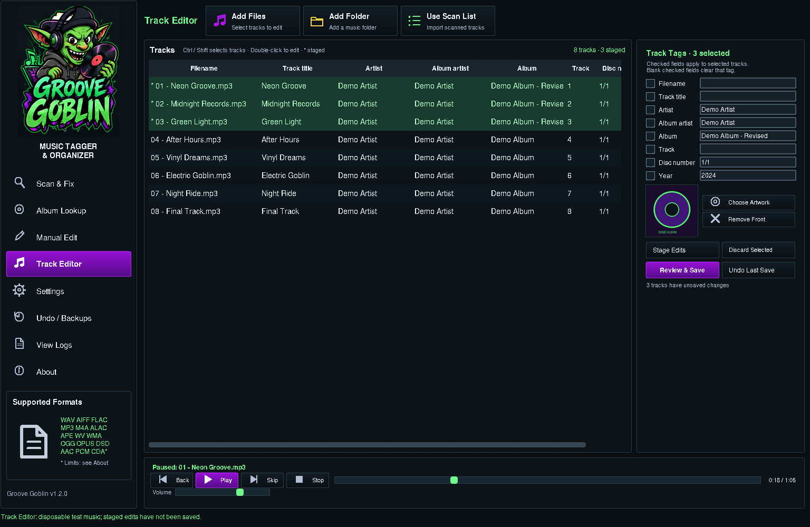

# Groove Goblin 1.2.0

Windows desktop music tagger and organizer with a responsive dark Tkinter
interface, MusicBrainz album lookup, naming presets, manual track editing,
local cover-art replacement, playback, previews and Undo. Supports multiple audio containers; [see the format matrix and limits](docs/formats.md).


## Run on Windows

Extract the entire project into a new writable folder. Double-click
`START_GROOVE_GOBLIN.bat` and leave its console open for diagnostics. The launcher
finds Python 3.10+, checks Tk, installs missing Mutagen, Pillow, pygame-ce and imageio-ffmpeg
packages, and runs the application with that same interpreter. Initial package
installation requires internet; local editing and playback do not.

If detection fails, drag your installed `python.exe` onto the launcher.
`VERIFY_PYTHON.bat` checks prerequisites without installing them. See
`LAUNCH_HELP.txt`. From Command Prompt inside the extracted app folder:

```bat
"C:\path\to\python.exe" -m pip install --user -r requirements.txt
"C:\path\to\python.exe" GrooveGoblin.pyw
```

## Scan, match and organize

1. Add Folders or Add Files, or drop folders / supported music files from Explorer.
   New drops automatically scan; duplicate-only, unsupported and busy drops do
   not restart scanning. Add buttons wait for Start Scan.
2. Scan is read-only. Search online after scan controls MusicBrainz lookup.
   Review and approve suggested artist, album and original release year, or
   correct the album fields yourself. Suggestions are never silently approved.
3. Select naming formats in Rename Options: eight filename presets and seven
   album-folder presets. [See formats and examples](docs/naming-formats.md).
   Filename renaming defaults off; its default format is `## - Artist - Title`.
4. Use album checkboxes to include or exclude albums. Review Folders, File Tags,
   File Names and Skipped. Apply Selected Changes asks for confirmation.
5. Save Report exports a read-only preview. Undo / Backups restores the last
   operation from its journal; View Logs shows diagnostic information.

MusicBrainz receives artist/album search text, never audio files. Public Cover
Art Archive previews are held in memory; viewing one does not embed it in music.
Missing internet or artwork leaves a placeholder and does not block local work.

## Track Editor

Select **Track Editor** in the left sidebar. Add files or folders, or use the
scanned list. A drop while this screen is open scans and imports the new tracks.

- Edit filename, title, artist, album artist, album, track number, disc number
  and year. Double-click a table cell and press Enter to stage an individual
  value; Escape cancels the cell edit.
- Select multiple rows with Ctrl / Shift. Edit the fields in the right panel
  and click Stage Edits to apply those values to the selection. Only checked
  fields change. Mixed values are blank and unchecked; checking a blank field
  explicitly clears that tag. Other fields remain untouched.
- Choose Artwork selects an image from your PC for all selected tracks. Remove
  Front removes the front cover. Other embedded pictures remain untouched.
- Staging is read-only and marked with an asterisk. Review & Save shows each
  actual change and the full-file backup size. Save Changes commits the edits.
  Discard Selected drops staged changes for the selected rows.
- Playback prepares a temporary listening copy for additional formats in a background worker; the source stays unchanged. PCM asks for its sample settings.
- Play / Pause, Back, Skip and Stop operate on the selected tracks, or the full
  table when a single track is selected. The player has volume, a seek bar and
  elapsed / total time. Back restarts the current track after three seconds;
  otherwise it goes to the previous track. MP3 seeking can be approximate.
- Undo Last Save restores the latest manual save. Scan & Fix renames also
  update loaded editor paths while preserving staged edits.



## Music safety and limits

Scanning, lookup and staging are read-only. Saves and organizer applies require
confirmation. Manual edits touch only explicitly selected fields and front art;
organizer tag updates touch album/year. Neither transcodes audio. Unrelated tags
and other artwork remain intact. Filename edits stay in the same directory and
preserve the audio extension. Existing output paths and stale-file conflicts
are rejected.

Manual saves make full-file backups in `Logs/ManualBackups` before modifying
music and record an undo journal in `Logs`. Backups use roughly the original
files' total size plus one temporary file during saving. Keep those backups and
journals together to use Undo. Manual Undo refuses to overwrite files changed
externally after saving. Organizer journals store targeted tag values and
original paths, not full audio backups; keep separate music backups.

Add Files scopes an organizer operation to the selected tracks. Renaming their
folder is blocked when unselected audio would be moved with it. Folder presets
rename within the current parent and do not create artist trees. Grouping is
by music-containing directory; separate mixed-album folders before organizing.
Raw AAC/PCM allow filename editing and playback; CDA files are read-only CD references. Embedded tag/artwork support depends on the container; see the format matrix. This distribution is source
with a launcher, not a standalone EXE.

## Window sizing and keyboard

Track Editor uses the same rounded panels and icon buttons as Scan & Fix, with
alternating dark rows, green selection/staging accents and a framed player.
Tables use slim rounded scrollbars; player sliders have green handles.

The app fits windows down to 800×600 without an outer scrollbar. Lists scroll
internally when needed. Resizing reduces artwork and spacing and uses sidebar
icons with hover labels on compact screens. The branding caption uses two lines
to fit. [Compact Scan & Fix](docs/interface-compact-linux.png) and
[compact Track Editor](docs/track-editor-compact-linux.png) show the actual UI.
Tab navigates controls, Ctrl / Shift selects multiple editor rows, F11 enters
fullscreen and Esc exits. Ctrl +/- adjusts organizer table text. About and the
sidebar display version 1.2.0.

Screenshots were captured on a Linux virtual display with disposable generated
audio and covers; online results are mocked. They show the running application,
not the original design mockup. Windows fonts and DPI rendering can differ.

## Validation

Install requirements and ffmpeg (used only to generate disposable test audio).
Run the suite with a Tk display available:

```bat
"C:\path\to\python.exe" -m unittest discover -s tests -v
```

Tests cover FLAC/MP3 scan → preview → apply → Undo; filename/folder presets;
case-insensitive collisions and stale files; individual and batch manual edits;
front-art replacement/removal with other art and tags preserved; byte-for-byte
manual Undo; partial failures and external-edit protection; live GUI workflows,
resize bounds, staging without writes, drop auto-scanning, and editor paths after
organizer renames/Undo. Playback checks stream real generated MP3 and FLAC files
through SDL's test audio device and exercise transport, seeking and volume.

54 tests passed on Linux/Python 3.12; two Windows-only tests were skipped.
Linux validation cannot establish actual Windows audio-device,
Python 3.15 playback or 125%/150% DPI behavior. The PowerShell launcher and native
Windows message-loop subprocess tests are skipped on Linux. The user confirmed
Explorer drops work with the queued native implementation on Python 3.15.
Native callbacks never invoke Tk; a Tk timer handles queued drop paths.

The additional format checks include real generated encodings, synthetic DSD streams and a synthetic APE header. See [format validation details](docs/formats.md).
No real user media or live MusicBrainz requests are used in the tests.

## Source and licensing

`GrooveGoblin.pyw` owns the controller/background queue. `groove_layout.py`,
`groove_responsive.py` and `groove_widgets.py` build the UI. `groove_core.py` and
`groove_naming.py` handle organization/presets. `groove_track_editor.py`,
`groove_manual.py` and `groove_player.py` provide manual editing, full-file Undo
and streamed playback. `groove_formats.py` maps container tags/artwork and capabilities; `groove_decode.py` prepares temporary listening copies. `groove_version.py` defines the application version.
Artwork, MusicBrainz and native queued drops live in their corresponding
`groove_artwork.py`, `musicbrainz_client.py` and `groove_windows_drop.py` modules.
Original branding stays in `assets/`; `GUI_Preview.png` is the original mockup.

See `CHANGELOG.md` and `LICENSE_NOTES.txt`. Dependencies are installed separately;
no generated audio, runtime binaries or user media are distributed in source.
Handoff documents describe the broader roadmap, not completed features.
