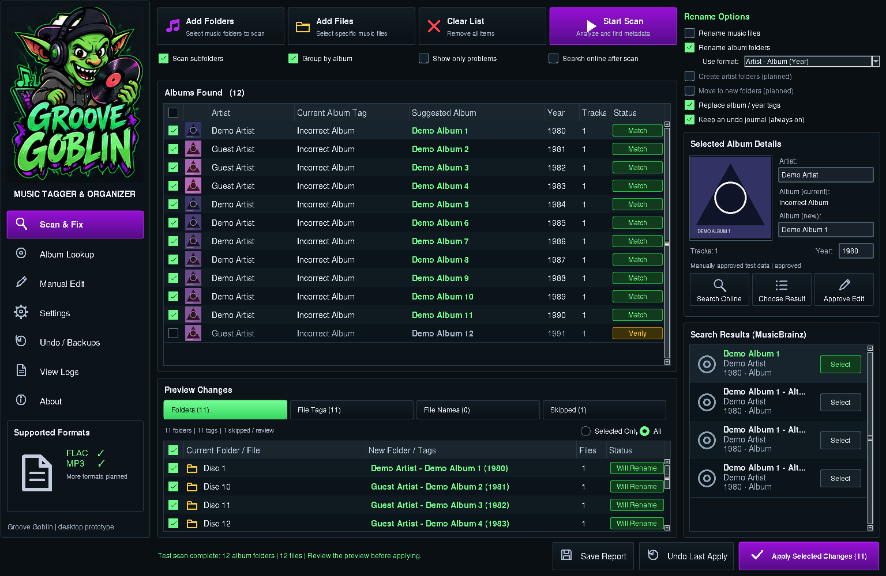

# Groove Goblin

Windows desktop music tagger and organizer. Python 3.10+, Tkinter and Mutagen.

This revision brings the existing Tkinter prototype closer to the supplied design:
large goblin wordmark and navigation on the left, albums above a read-only preview
in the center, and rename options, editable album details and MusicBrainz results
on the right. It retains the existing music engine and apply/undo confirmations.
It is not a pixel-perfect reproduction of the design image.



The image above is the running application, not the original mockup. Windows
fonts and controls may render differently.

## Run on Windows

Extract the entire project to a writable folder and double-click
`START_GROOVE_GOBLIN.bat`. It detects a usable Python installation, tests Tkinter,
installs Mutagen if necessary, and runs the app with that exact interpreter.
Leave the console open. It preserves startup errors for troubleshooting.
If detection fails, drag your installed `python.exe` onto the launcher.
See `LAUNCH_HELP.txt` for more diagnostics.

For a command-line launch, open Command Prompt in this folder:

```bat
"C:\path\to\python.exe" -m pip install --user -r requirements.txt
"C:\path\to\python.exe" GrooveGoblin.pyw
```

## Workflow

Add folders (subfolders are scanned), Start Scan, select an album, correct its
artist/album/year or choose a MusicBrainz result, Save & Approve Match, inspect
the preview, then explicitly Apply Selected Changes. Use Include / Skip to
exclude an album. Preview filters show folder, tag or filename changes.
Save Report exports a dry-run report; Undo Last Apply uses the saved journal.

MusicBrainz searches send artist/album lookup text to MusicBrainz. They do not
upload audio. Disable Search MusicBrainz after scan for offline/manual use.

At smaller window sizes, scroll the workspace horizontally/vertically to reach
all panels. The Apply, Undo and Report buttons remain outside the scroll area.
A divider adjusts the album/preview split. Ctrl +/- adjusts text size, F11 toggles
fullscreen and Esc exits fullscreen.

## Scope and limitations

- FLAC and MP3 only. Other formats in the design image are not implemented.
- Folder name: `Artist - Album Title (Year)`; filename renaming defaults off.
- Scanning, lookup and preview are read-only. Apply requires confirmation.
- Each directory containing music is treated as one album.
- Matching may be incorrect: review and approve individual albums.
- Undo is a targeted metadata/path journal, not a complete music backup.
- Artwork thumbnails, Add Files, artist-folder creation, and other controls from
  the reference image are not implemented in this revision.
- This is source code, not a compiled EXE. Actual Windows GUI/DPI testing remains
  necessary; do not treat Linux display checks as Windows certification.

Try scans and apply/undo on a copy of a small music folder first.

## Validation

Requires Mutagen and ffmpeg (tests generate disposable FLAC/MP3 files).

```bat
"C:\path\to\python.exe" -m unittest discover -s tests -v
```

Eight tests passed under Python 3.12 on Linux with a virtual Tk display:
five existing core tests plus GUI workflow and 800x600/1024x768/1920x1080 layout
checks, plus launcher probes tested with legacy quote removal. The actual
Windows PowerShell launch test is skipped on Linux; it still needs a Windows
run. GUI tests skip when no display is available. No live online requests or
real user music are used by these tests. Windows launcher and DPI are unverified.

## Source

- `GrooveGoblin.pyw`: existing UI workflow/controller; captures scan settings on
  the main thread before starting the worker.
- `groove_layout.py`: reference-inspired layout and preview filters.
- `groove_core.py`: existing scan, preview, tag edits, moves and undo engine.
- `musicbrainz_client.py`: MusicBrainz lookup, timeouts and rate limiting.
- `legacy_collections.py`: existing Van Halen collection mappings.
- `Launch-GrooveGoblin.ps1`: exact-interpreter Windows startup/diagnostics.
- `assets/`: original branding.

The handoff documents describe a broader roadmap, not completed features.
Read `LICENSE_NOTES.txt` before any public redistribution.
